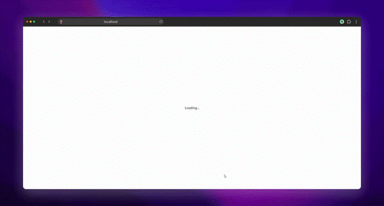
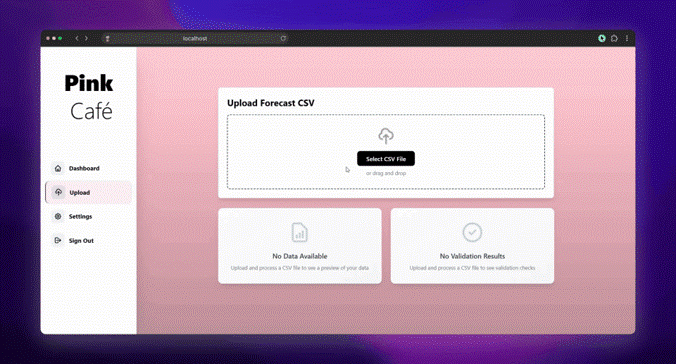
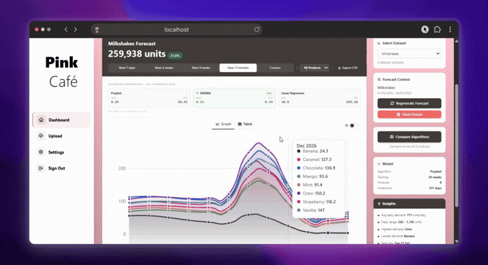
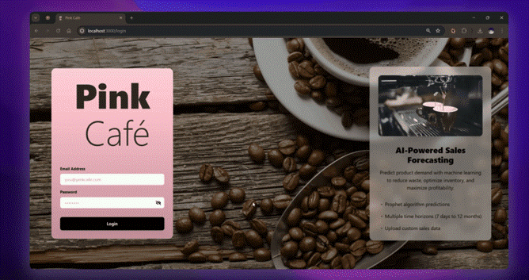
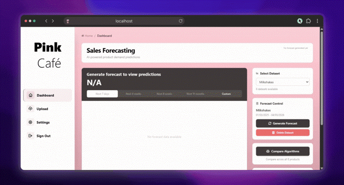
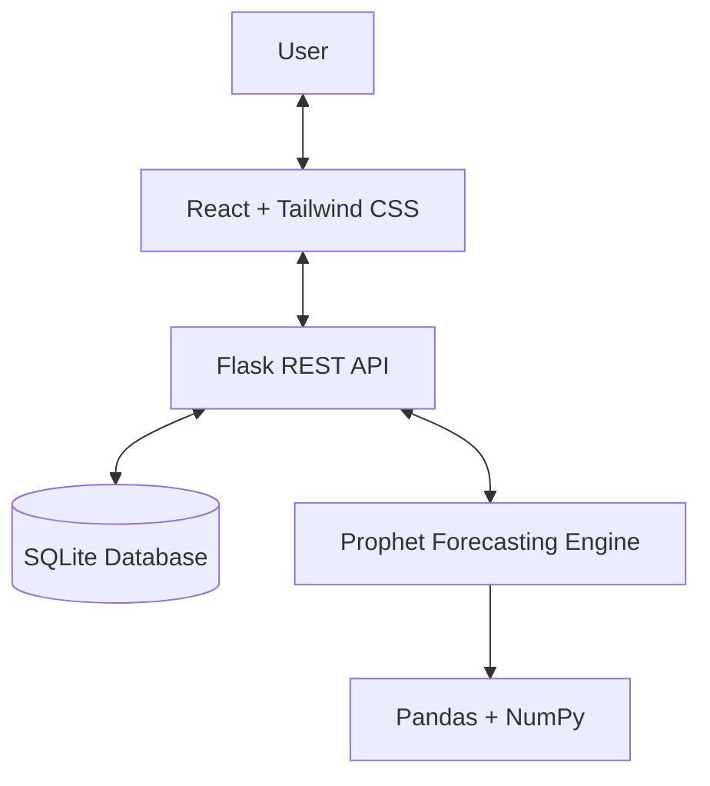

# Bristol-Pink Café, AI-Powered Sales Forecasting
**A full-stack sales forecasting platform powered by machine learning.**

Developed by a five-person team at the University of the West of England (UWE Bristol) for the *Systems Development Group Project* module, 2025–2026.

Bristol-Pink is a five-location bakery café chain serving food and coffees. This prediction platform analyses historical sales of selected products and uses Meta's Prophet time-series model to forecast demand, helping café managers make informed daily purchasing decisions, reduce food waste and minimise losses. It provides interactive sales visualisations, configurable forecasting options and model evaluation metrics, with forecasts generated for individual or combined products.

---

## Overview

The platform combines sales analytics, configurable forecasting and an interactive dashboard to support data-driven purchasing decisions.

| Feature | Description |
|---|---|
| **Sales Forecasting** | Generate configurable, per-item demand forecasts using Prophet |
| **Interactive Dashboard** | Explore historical sales, forecast trends and demand predictions |
| **CSV Data Import** | Upload sales datasets for processing and analysis |
| **Model Configuration** | Manage reusable Prophet presets and model parameters |
| **Forecast Evaluation** | Compare Prophet, SARIMA and linear-regression backtests using MAE and MSE |
| **User Authentication** | Secure login with bcrypt password hashing |

## Demo
The following short GIFs demonstrate the web application's key features, showcasing each page and its functionality, including navigation and responsive design.

### Dashboard

*Displays sales predictions with selectable forecast periods of 7 days, 4 weeks, 8 weeks or a custom range, alongside a table view of forecast results.*

### CSV Uploads Page

*Allows users to upload sales data in CSV format, which is then parsed and ingested into the database for analysis and forecasting.*

### Settings Page

*Enables users to manage Prophet presets, including creating, copying, editing and deleting configurations for reusable forecasting parameters.*

### Login, Navigation and Responsive Design
<p align="center">
<div>
  
  
</div>
<p align="center" ><em>Demonstrates the login process, navigation between pages, and responsive design on different screen sizes.</em></p>
</p>

### Figma Prototype Designs

*Application interface designs created in Figma before frontend implementation.*

---

## Architecture

The application uses a containerised development setup with a React frontend and Flask backend. Prophet forecasting and the optional SARIMA/linear-regression comparison run as backend Python modules rather than as a separate network service. A production Docker target serves the compiled React application from Flask.



### Technology Stack

| Component | Technologies |
|---|---|
| Frontend | React, Tailwind CSS, Recharts |
| Backend | Python, Flask, REST API |
| Database | SQLite |
| Forecasting | Meta Prophet, SARIMA (statsmodels), linear regression (scikit-learn), Pandas, NumPy |
| Security | bcrypt, token-based authentication |
| Deployment | Docker, Docker Compose |
| CI | GitHub Actions |

### Forecasting Pipeline

The backend processes uploaded sales data, trains the forecasting model and returns predictions for visualisation in the dashboard.

The backend accepts training windows from four to 52 weeks. The dashboard currently requests a 20-week training window for its forecasts and algorithm comparisons; the API also supports other valid values.

---

## Setup

### Prerequisites

- Git
- Docker
- Docker Compose

### Installation

Clone the repository and start the application:

```bash
git clone https://github.com/shamykyzer/sales-prediction-platform.git
cd sales-prediction-platform
docker compose up --build
```

Allow the containers to build and start before opening the application.

### Service URLs

| Service | URL |
|---|---|
| Frontend | [http://localhost:3000](http://localhost:3000) |
| Backend API | [http://localhost:5001/api](http://localhost:5001/api) |
| Backend status | [http://localhost:5001](http://localhost:5001) |

### Demo Credentials

| Field | Value |
|---|---|
| Email | `admin@pinkcafe.com` |
| Password | `pinkcafe2025` |

---

## Testing

The system was tested thoughout development with each new feature added, covering functional behaviour, security, API integration, performance and accessibility.

Testing included CSV ingestion, forecast generation, invalid authentication, duplicate registration, SQL injection handling, input validation and Prophet preset management.

See the [full test plan](documentation/Systems Development Group Report.pdf) in the main report for individual test cases and results.

---

## Team & Contributions

Developed collaboratively by five Computer Science students at UWE Bristol.

| Team member | Main responsibilities |
|---|---|
| Nickolas Greiner | Backend development, database and authentication |
| Aaron Antal-Bento | Full-stack development, ML integration and settings |
| Oliver Mercer | Frontend development and documentation |
| Oliver Churchley | Frontend development and Prophet implementation |
| Ahmed AlShamy | Backend architecture, DevOps, UI design and algorithm evaluation |

The team used GitHub for version control and collaboration, with Docker for reproducible deployment and GitHub Actions for automated build and test checks.

---

## Documentation

Additional project artefacts and technical documentation:

| Resource | Description |
|---|---|
| [Systems Development Group Report](documentation/SystemsDevelopmentGroupReport.pdf) | Full project report with requirements, design, implementation and testing |
| [Figma Designs](documentation/FigmaDesigns.png) | Application interface designs |
| [Use Case Diagram](documentation/UseCaseDiagram.png) | Actors and system interactions |
| [Backend Class Diagram](documentation/ClassDiagram1.png) | Application classes and relationships |
| [Database Class Diagram](documentation/ClassDiagram2.png) | SQLite schema and data relationships |
| [CSV Upload Sequence](documentation/SequenceDiagram1.png) | Sales ingestion and graph rendering flow |
| [Forecast Sequence](documentation/SequenceDiagram2.png) | Model training, prediction and chart rendering |
| [Project Gantt Chart](documentation/gantt_chart.png) | Project schedule, tasks and milestones |

---

<div align="center">

**Bristol-Pink Café Sales Forecasting System**

*Systems Development Group Project · UWE Bristol · 2025–2026*

</div>